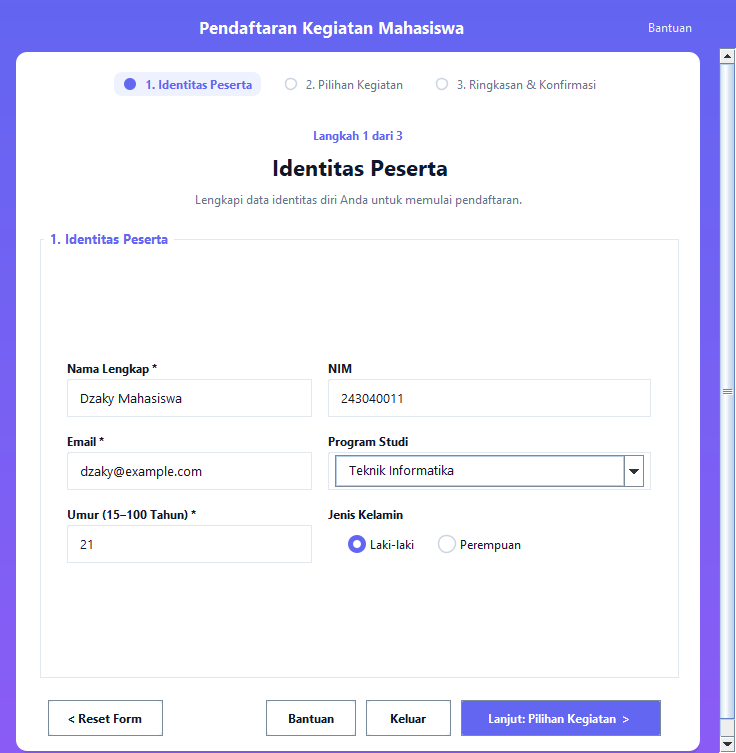
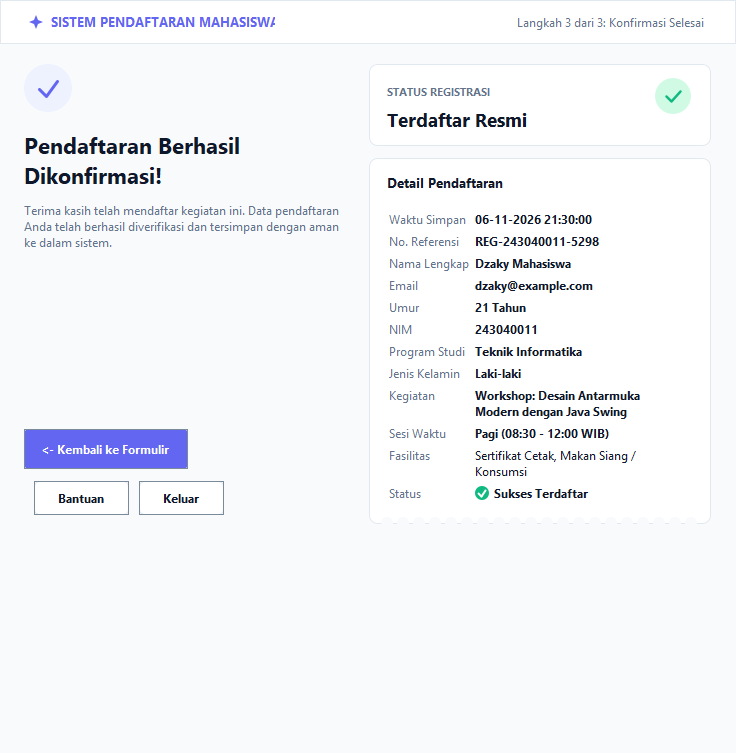
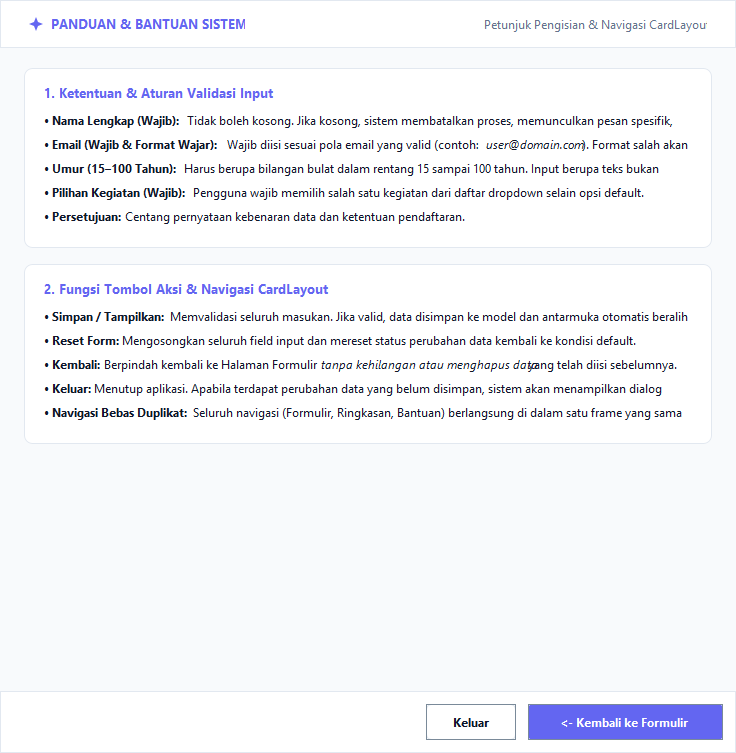
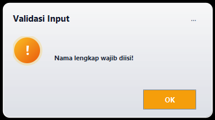
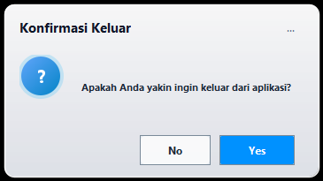
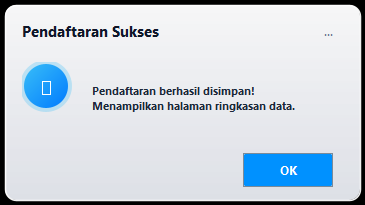

Laporan Ringkas Pengujian Aplikasi Pendaftaran Kegiatan (Tugas 2)

Mata Kuliah: IF21W0508 – Praktikum Pemrograman II  
Nama Mahasiswa: Dwi Dzaky Wibowo 
NIM: 243040011  
Tanggal Pengujian: 06 November 2026  


1. Pendahuluan & Ringkasan Fitur

Pada Tugas 2 ini, aplikasi formulir pendaftaran mahasiswa dikembangkan lebih lanjut dengan menambahkan arsitektur Event Handling, validasi data terpusat, dan navigasi multi-halaman berbasis CardLayout.

Fitur Utama yang Diimplementasikan (Bagian 1):
1. Navigasi 3 Halaman via CardLayout:
   - Halaman Formulir (`CARD_FORM`): Antarmuka masukan data peserta, kegiatan, dan persetujuan.
   - Halaman Ringkasan (CARD_RINGKASAN): Menampilkan rincian data pendaftaran yang telah berhasil divalidasi dan disimpan.
   - Halaman Bantuan (CARD_BANTUAN): Panduan aturan validasi dan penjelasan fungsi setiap tombol antarmuka.
   - Semua transisi halaman terjadi pada satu jendela tunggal (JFrame) tanpa membuka jendela/pop-up duplikat.
2. Validasi Masukan Pengguna (Ketat & Spesifik):
   - Nama Lengkap: Wajib diisi. Jika kosong, muncul pesan "Nama lengkap wajib diisi!" dan kursor otomatis fokus ke `txtNama`.
   - Email: Wajib berformat wajar (contoh: `nama@domain.com`). Jika tidak valid, muncul pesan "Format email tidak valid!" dan fokus ke `txtEmail`.
   - Umur: Wajib berupa bilangan bulat dalam rentang 15–100 tahun. Jika bukan angka atau di luar rentang, muncul pesan peringatan spesifik dan fokus ke `txtUmur`.
   - Pilihan Kegiatan: Wajib memilih salah satu opsi kegiatan selain opsi default (-- Pilih Kegiatan --).
   - Masukan yang salah dibatalkan (tidak diproses) hingga pengguna memperbaikinya.
3. Pencegahan Kehilangan Data & Konfirmasi Keluar:
   - Sistem memantau status perubahan data input (*dirty checking*).
   - Jika tombol Keluar ditekan saat terdapat isian yang belum disimpan, sistem memunculkan dialog konfirmasi: "Ada perubahan data yang belum disimpan. Apakah Anda yakin ingin keluar?".
   - Jika pengguna memilih Tidak, penutupan aplikasi dibatalkan (*cancellation of exit*), menjaga data tetap aman.
4. Tombol Kembali Tanpa Kehilangan Data:
   - Dari Halaman Ringkasan, pengguna dapat menekan tombol "<- Kembali ke Formulir". Halaman kembali ke formulir dengan seluruh data yang telah diisi tetap utuh.


2. Tabel Hasil Pengujian Skenario (Bagian 2)

Pengujian dilakukan untuk membuktikan pemenuhan seluruh kriteria pada Tugas Bagian 2:

| No | Skenario Pengujian | Masukan Uji (*Input*) | Ekspektasi Sistem | Hasil Pengamatan | Status |
1 | Uji Nama Kosong | Nama: `""` (kosong)<br>Email: `dzaky@mail.com`<br>Umur: `20`<br>Kegiatan: `Workshop Swing` | Data tidak diproses, muncul pesan *"Nama lengkap wajib diisi!"*, kursor fokus ke field Nama. | Pesan peringatan spesifik muncul, kursor aktif di field Nama, form tidak tersimpan. | BERHASIL (PASS) |
2| Uji Email Salah | Nama: `Dzaky`<br>Email: `dzaky-bukan-email`<br>Umur: `20`<br>Kegiatan: `Workshop Swing` | Data tidak diproses, muncul pesan "Format email tidak valid!", kursor fokus ke field Email. | Dialog kesalahan format muncul dengan contoh format benar, kursor fokus ke field Email. | BERHASIL (PASS) |
3 | Uji Umur Bukan Angka | Nama: `Dzaky`<br>Email: `dzaky@mail.com`<br>Umur: `dua puluh`<br>Kegiatan: `Workshop Swing` | Data tidak diproses, muncul pesan *"Umur harus berupa angka bilangan bulat!"*, kursor fokus ke field Umur. | Terdeteksi bukan bilangan bulat, muncul pesan kesalahan, kursor fokus ke field Umur. | BERHASIL (PASS) |
4 | Uji Umur Di Luar Rentang | Kasus A: Umur `12` (< 15)<br>Kasus B: Umur `105` (> 100) | Data tidak diproses, muncul pesan "Umur harus berupa bilangan bulat antara 15 sampai 100 tahun!", kursor fokus ke field Umur. | Muncul dialog rentang umur 15-100, masukan ditolak, kursor fokus ke field Umur. | BERHASIL (PASS) |
5 | Uji Kegiatan Belum Dipilih | Nama: `Dzaky`<br>Email: `dzaky@mail.com`<br>Umur: `21`<br>Kegiatan: `-- Pilih Kegiatan --` | Data tidak diproses, muncul pesan "Pilihan kegiatan wajib dipilih!", kursor fokus ke dropdown Kegiatan. | Peringatan kegiatan wajib muncul, form tidak tersimpan, kursor fokus ke dropdown. | BERHASIL (PASS)|
6 | Uji Input Valid | Nama: `Dzaky Mahasiswa`<br>Email: `dzaky@example.com`<br>Umur: `21`<br>NIM: `243040011`<br>Kegiatan: `Workshop Java Swing` | Validasi lolos, dialog sukses muncul, CardLayout berpindah ke Halaman Ringkasan. | Seluruh data berhasil disimpan dan ditampilkan lengkap di Halaman Ringkasan. | BERHASIL (PASS) |
7 | Uji Kembali Tanpa Kehilangan Data | Dari Halaman Ringkasan, klik tombol "<- Kembali ke Formulir". | CardLayout kembali menampilkan Halaman Formulir, seluruh field tetap terisi data sebelumnya. | Halaman formulir tampil kembali dengan isi Nama, Email, Umur, NIM, dll. tetap utuh. | BERHASIL (PASS) |
8 | Uji Reset Form | Mengisi beberapa data, lalu klik tombol "Reset Form". | Seluruh field kosong, dropdown ke index 0, radio/checkbox unselected, kursor ke field Nama. | Seluruh form kembali bersih, status perubahan di-reset, fokus aktif di field Nama. | BERHASIL (PASS) |
9 | Uji Pembatalan Konfirmasi Keluar | Ketik data di form (unsaved changes), klik tombol "Keluar", pilih "Tidak". | Muncul dialog konfirmasi perubahan belum disimpan. Saat pilih "Tidak", aplikasi tetap buka. | Aplikasi membatalkan keluar, jendela tetap terbuka, data tidak hilang. | BERHASIL (PASS) |


3. Tangkapan Layar Antarmuka Aplikasi
Berkas tangkapan layar tersimpan pada folder `screenshots/`:

A. Halaman 1: Formulir Pendaftaran (`CARD_FORM`)
Tampilan formulir pendaftaran interaktif lengkap dengan penataan `GridBagLayout`, field validasi (Nama, Email, Umur, Kegiatan), serta panel tombol navigasi.


B. Halaman 2: Ringkasan Pendaftaran (`CARD_RINGKASAN`)
Tampilan ringkasan setelah pendaftaran berhasil disimpan, dilengkapi tombol kembali tanpa kehilangan data.


C. Halaman 3: Panduan & Bantuan (`CARD_BANTUAN`)
Tampilan halaman bantuan yang memuat seluruh aturan validasi dan penjelasan fungsi navigasi aplikasi.



4. Desain Pop-Up Modern (Glassmorphism UI)

Sistem dialog pop-up standar (`JOptionPane`) telah digantikan oleh komponen kustom [`ModernDialog.java`](file:///d:/praktikum%20smstr%205/Praktikum%20Pemograman%20II/ModernDialog.java) yang mengadopsi tema Glassmorphism UI (kartu transparan melengkung, ikon glowing menyala, dan tombol pill modern):

1. Pop-Up Validasi Input (Warning / Error):
   - Ikon lingkaran oranye menyala (`!`), pesan spesifik kesalahan, dan tombol pill oranye `OK`.
-	

2. Pop-Up Konfirmasi Keluar (Confirm):
   - Ikon lingkaran biru menyala (`?`), pesan konfirmasi keluar / perubahan belum disimpan, tombol `No` (glass) dan `Yes` (biru).
   - 

3. Pop-Up Pendaftaran Sukses (Success):
   - Ikon lingkaran biru/cyan menyala (`✓`), pesan pendaftaran berhasil disimpan, dan tombol pill biru `OK`.
   - 


5. Bukti Hasil Eksekusi Program Uji Otomatis

Eksekusi kelas pengujian otomatis `TestSkenarioTugas2` menghasilkan status kelulusan 100%:

```text
======================================================================
          PENGUJIAN SKENARIO TUGAS 2 (IF21W0508 - PRAKTIKUM PBO II)   
======================================================================
[PASS] 1. Uji Nama Kosong: Terdeteksi kosong, validasi memblokir.
[PASS] 2. Uji Email Salah: Pola email salah terdeteksi.
[PASS] 3. Uji Umur Bukan Angka: Parsing gagal terdeteksi NumberFormatException.
[PASS] 4. Uji Umur Di Luar Rentang: 12 dan 105 terdeteksi tidak valid (15-100).
[PASS] 5. Uji Kegiatan Belum Dipilih: Index 0 ('-- Pilih Kegiatan --') terdeteksi.
[PASS] 6. Uji Input Valid: Seluruh data memenuhi kriteria validasi.
[PASS] 7. Uji Kembali Tanpa Kehilangan Data: Data form tetap utuh.
[PASS] 8. Uji Reset: Semua input kosong, index 0, unsaved changes false.
[PASS] 9. Uji Deteksi Perubahan Unsaved Changes: Mengetik memicu unsaved changes.
======================================================================
TOTAL HASIL PENGUJIAN: 9 / 9 BERHASIL (PASSED)
======================================================================
```

---

6. Kesimpulan
Seluruh spesifikasi pada Tugas 2 (Bagian 1 dan Bagian 2) telah diimplementasikan dan diverifikasi dengan sukses:
1. Navigasi CardLayout bekerja efisien tanpa membuka jendela duplikat.
2. Validasi masukan nama, email, umur (15–100), dan kegiatan berjalan ketat dengan pesan kesalahan spesifik dan pemfokusan kursor (`requestFocus()`).
3. Pencegahan kehilangan data dan pembatalan konfirmasi keluar berfungsi secara tepat.
4. Fungsi Reset dan Kembali menjaga integritas data formulir sesuai harapan.


